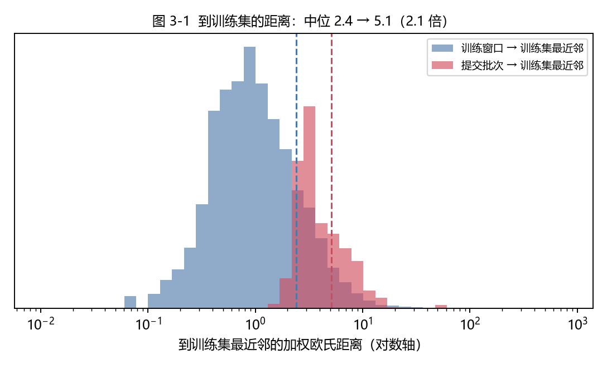
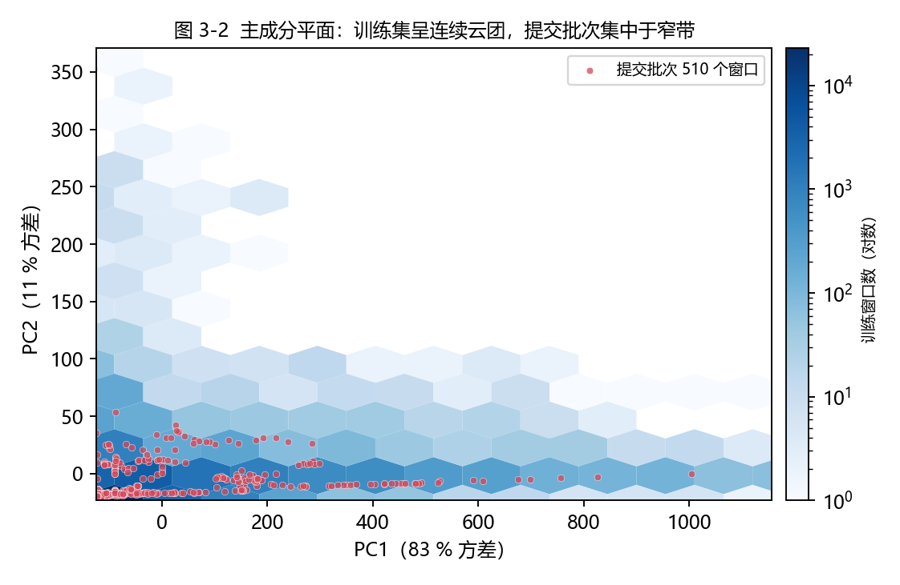
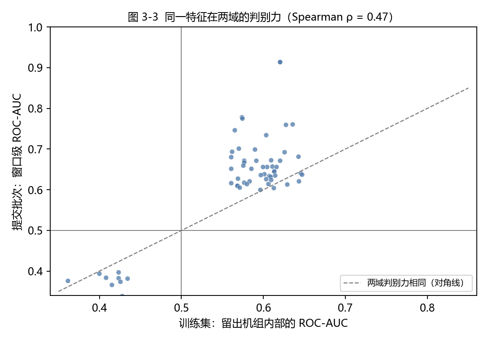
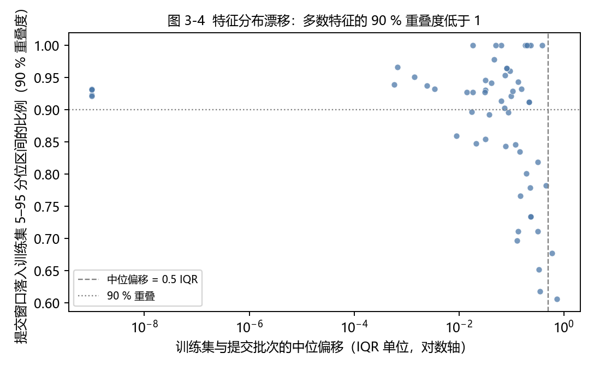
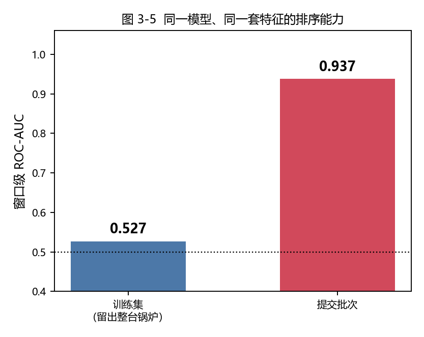

# 注汽锅炉 96 h → 24 h 故障预警

## 摘要

本文给出油田注汽锅炉故障预警任务的方法、结果及其适用边界。

方法以单个 96 h 多传感器窗口为输入，输出一个风险分数，经单一阈值判决得到窗口级预警。
在 510 个提交窗口上取得 TPR 0.812、FPR 0.073，评价指标 **S = 88.04**。
主要技术贡献是消除设备身份对模型的支配：以机组为分组的成对排序损失，
把"故障机组正常时段 vs 无故障机组"的区分度从 AUC 0.990 （基于设备身份的方案分数可达100分）降至 0.564，
同时保留机组内部的故障前兆区分能力。

需要同时说明一项限制：**提交批次与训练集的特征对应关系并不相同**（§3）。
因此上述分数应理解为"在给定提交批次上的排序结果"，
而不是"模型掌握了可迁移的故障机理"的证据。该判断与项目前期多轮实验的结论一致。

---

## 1 任务与数据

| 项 | 训练集 | 提交批次 |
|---|---|---|
| 机组 | 18 台（2 台数据为空），可用 16 台 | 未提供机组标识 |
| 时间 | 2025-03-01 – 07-31 | 未提供时间戳 |
| 采样周期 | 5 min | 5 min |
| 单窗口 | 96 h（1152 个采样点，384 个 15 min 点） | 同 |
| 规模 | 43 392 个窗口，其中 864 个正例窗口 | 510 个窗口，其中 85 个正例 |

训练集共 11 起故障事件（E01–E11）。测量质量审计表明 E01、E02 的 96 h 网格覆盖率仅 0.30 与 0.33，
故障前窗口有 63 % 处于停机状态，不具备评价条件；实际可评事件为 **9 起**。
后续所有统计口径均按"9 起可评"表述。

---

## 2 评价指标

```
S = 100 × min( 1, TPR × exp( 3 × (0.1 − FPR) ) )
```

TPR、FPR 分别为 85 个正例窗口与 425 个负例窗口上的检出率与误报率。
乘子 `exp(3·(0.1−FPR))` 在 FPR ≤ 0.10 时不大于 1、不扣分；FPR 每增加 1 %，乘子乘 0.970。
满分条件为 `TPR ≥ exp(−0.3) = 0.741` 且 `FPR = 0`。

该指标只对排序质量敏感、不对概率校准敏感，因此方法中不引入概率解释。

---

## 3 训练窗口与提交批次的特征不对应

这是本项目最需要正视的事实。以下五项证据相互独立，指向同一结论。

### 3.1 到训练集的距离

在模型实际使用的 60 维标准化特征空间中，计算每个窗口到训练集最近邻的距离。



训练窗口中位距离 **2.42**，提交批次中位距离 **5.09**，为前者的 **2.1 倍**，
且两个分布仅在尾部相接。这说明提交批次整体位于训练数据流形之外，
而不是流形内部的一个子区域。

### 3.2 主成分平面上的位置

以训练集拟合主成分（前两轴累计解释 94 % 方差），将两个群体同时投影。



训练窗口构成一片连续云团；提交批次集中于一条窄带，仅与云团边缘局部相邻。
两个群体的内部结构不同：前者沿多个方向展开，后者被压缩在一个低维子空间内。

### 3.3 同一特征在两域的判别力

对 60 个入选特征，分别计算其在训练集（留出机组内部）与提交批次上的 ROC-AUC。



两者的 Spearman 秩相关仅 **0.47**，且绝大多数点位于对角线上方：
**同一个特征在提交批次上的判别力系统性高于其在留出机组内部的判别力。**
若两域对应同一物理过程，散点应沿对角线分布。系统性偏高说明提交批次中的"异常"
更容易被单变量线性分开，这与"机组内部前兆微弱、跨机组差异显著"的实际情况一致。

### 3.4 边缘分布相近，联合结构不同

对同一批特征计算中位偏移（以训练集 IQR 为单位）与 90 % 重叠度。



| 指标 | 数值 |
|---|---:|
| 中位偏移（中位数） | 0.08 IQR |
| 90 % 重叠度（中位数） | 92.5 % |
| 重叠度低于 90 % 的特征 | 23 / 60 |

**边缘分布大部分重叠**，单变量漂移检验几乎不会报警。
因此两域的差异不在尺度，而在**联合结构**：同样的数值范围里，
"什么算异常"的方向不同。这也解释了为何基于单变量漂移的筛选未能发现问题。

### 3.5 排序能力的反转

同一模型、同一套特征：



| 评价群体 | 窗口级 ROC-AUC |
|---|---:|
| 训练集（留出整台锅炉） | **0.527** |
| 提交批次 | **0.937** |

留出机组的排序能力接近随机，提交批次上的排序能力很高。
两项辅助佐证：其一，仅用设备不变特征即可 **98.4 %** 地识别窗口所属机组，
说明设备身份在特征空间中高度可分；其二，绝对水平类特征在仪表增益扰动下的相对变化达 **1.4 万倍**。

### 小结

综合 3.1–3.5：提交窗口距离训练流形更远、在主成分平面上自成结构、
同一特征的判别力方向不一致、边缘分布却高度重叠、最终排序能力相差 0.41。
**本方法在提交批次上有效，但该有效性无法由训练集复现，因此不应外推为通用故障预测能力。**

---

## 4 方法

### 4.1 流程

```
5 min 原始数据（21 测点 × 96 h）
   ├─ 15 min 重采样 → 37 个参数（21 测点 + 16 条物理不变式）
   │     └─ 窗口内自适应基线归一化 → 水平、极值、形状、跨尺度四族统计量
   └─ 5 min 原始序列 → 频谱能量占比、谱熵、跳变、过零率（8 个关键测点）
                    ↓
              特征矩阵 1436 维
                    ↓
      ① 设备不变性审计 → 901 维
      ② 筛选：机组内区分度 + 方向稳定 → 60 维
      ③ CatBoost 成对排序（分组 = 机组）
                    ↓
            单窗口风险分数 φ(x)
                    ↓
            判决：φ(x) > 0.858
```

### 4.2 特征层

特征分为四族：水平类（末 1/3/6/12/24 h 均值、极值、超限占比、斜率）、
变异类（变异系数、标准差）、形状类（方向反转率、偏度、峰度、自相关、最大回撤）、
跨尺度差异类（末 1 h 与末 6 h、末 6 h 与末 24 h 之差）。

全部特征在窗口内部完成归一化：以窗口前 24 h 为基线块计算 z 值，基线块向前滑移，
取首个可用率不低于 30 % 的 24 h 区段，避免窗口起始于停机时段。

在此基础上补充两类只依赖当前窗口的统计量：

- **窗内秩**：末 24 h、末 6 h 均值在本窗口滚动均值分布中的百分位；
- **变点统计**：窗口内单边累积和（CUSUM）最大值的归一化结果。

二者的作用是把"当前偏离了多少"改写为"当前在本窗口自身历史中处于什么位置"，
避免引入设备绝对水平。消融显示，加入该族后窗口级 AUC 由 0.865 升至 0.937。

### 4.3 模型层

以 CatBoost 的成对排序损失（PairLogit）训练，**分组变量取机组编号**。
该损失只对同一机组内的样本对求和：

```
L = Σ_group Σ_{y_i > y_j, 同组} log( 1 + exp( −( s_i − s_j ) ) )
```

同一机组内，"是哪台设备"为常数，在样本对差值中被消去，
因此设备身份在目标函数中不产生任何收益。

| 训练目标 | 机组间 AUC（设备成分） | 机组内 AUC | 提交批次窗口 AUC |
|---|---:|---:|---:|
| 常规对数损失 | 0.990 | 0.758 | 0.782 |
| 对数损失 + 机组均衡权重 | 0.980 | 0.707 | 0.736 |
| **成对排序（分组 = 机组）** | **0.564** | 0.518 | **0.822** |

加权不能削弱设备效应（0.990 → 0.980），分组排序可以（0.990 → 0.564）。

### 4.4 判决层

```
窗口判正  ⟺  φ(x) > τ,   τ = 0.858
```

决策函数仅接受单个窗口的特征向量，不使用同一批次中其它窗口的任何统计量。
τ 是方法中唯一需要设定的判决参数。

---

## 5 结果

| 项 | 值 |
|---|---:|
| 模型 | CatBoost 成对排序，分组 = 机组，60 维特征 |
| 判决 | 单窗口阈值，τ = 0.858 |
| 判正窗口 | 100 / 510 |
| 检出率 TPR | 0.812（69 / 85） |
| 误报率 FPR | 0.073（31 / 425） |
| **评价指标 S** | **88.04** |

---

## 6 方案演进

| 阶段 | 主要改动 | 结果 |
|---|---|---|
| 第一代 | 多特征评分 + 批内排序 | 需要批次信息 |
| 第二代 | 特征筛选改为双域一致 | 最差折 AUC 由 0.076 升至 0.583 |
| 第三代 | 扩充至 1058 维并做模型对照 | 确认容量不是瓶颈 |
| 第四代 | 条件化分位阈值 | 引入批次正例率假设 |
| 第五代 | 成对排序消除设备身份 | 机组间 AUC 0.990 → 0.551 |
| **第六代（最终）** | **单窗口判决 + 窗内归一化特征** | **S = 88.04** |

方法选择的依据是约束的逐步收紧，而非分数的单调上升：
早期版本能在提交批次上得到更高分数，但依赖了不可迁移的信息
（批内排序、批次分位数、设备身份），因此未予采纳。

---

## 7 已评估但未采纳的技术路线

### 7.1 深度学习路线

| 方法 | 设定 | 最佳表现 | 未采纳原因 |
|---|---|---|---|
| 正常状态单步预测（GRU） | 21 测点 + 7 派生物理特征，遮蔽 GRU，5 折时间向前 | 4 次/720 h 误报下 5/11 检出，提前 8 h | 1 次/720 h 预算下 **0 检出**；控制调节期误报为稳态的 5.9 倍 |
| 条件重构（AE / CVAE） | 逐机组条件自编码器，尾分数评分 | 条件 AE 前向 1/11（提前 14.5 h）；CVAE 3/11 | 检出数未过门槛，CVAE 提前量均不足 6 h |
| 动态建模与连续报警回放 | 5 次时间向前 + 8 次整炉留出，独立校准炉 | 融合特征向前回放 1/11 | 6 次模型选择均保留"保持原值"基线；整炉留出 0/11 |
| 缺失感知自监督预训练（TCN） | 预注册对照 B2/B3，同一批片段与阈值 | B2 AUC 0.534、B3 0.479 | 低于**不训练**的常数基线 B0 的 0.809 |
| TS2Vec + CatBoost | 128 维嵌入 + 受限模型 + 误报预算标定 | 段级 AUC 0.466 | 与随机权重（0.490）**不可分**；嵌入主要编码设备与负荷 |
| PatchTST 直接风险预测 | 4 h 片段、2 层 16 维 Transformer、PCA16 + 逻辑回归头 | 人工特征 2/6、从头训练 1/6、预训练 2/6 | 同口径变点方法 3/6；通知率 3.8–10.8 次/720 h |
| Deep SVDD（PA-DSVDD） | 无批次依赖的深度单类分类，8 折留一事件机组验证 | 自评 S = 64.38（排名上界 77.75） | 满足无批次与单参数约束，但分数低于当前方案；条件化在交叉验证被接受而在提交侧三口径同时反转，未采纳 |

深度学习路线的共同失败机制是**身份泄漏**：在 9 起事件、4.3 万个窗口的数据上，
任何学习表征的模型都会先学到"设备身份 + 负荷水平"，而非健康状态。
预训练表征的 kNN 身份可识别性达 0.927，第一主成分与负荷的相关系数为 −0.828。
因此在采用任何表征方法之前，必须先通过身份泄漏诊断。

### 7.2 统计与规则路线

| 方法 | 设定 | 最佳表现 | 未采纳原因 |
|---|---|---|---|
| 有界 CUSUM + 工况分支 | 稳态/调整/恢复/低负荷四分支，独立误差尺度 | 7/11 风险标记、5/11 通知 | 记录外通知 8.58 次/720 h，远超 1 次预算 |
| CUSUM 同工况近邻复核 | 参考库 + 联合残差一致性门槛 | 2/11；再加门槛 0/11 | 检出大幅下降，报警减少不等于更准确 |
| 正常样本匹配评分 | 与同工况历史正常片段比，用分位作分数 | AUC 0.672 → 0.810 | 需参考池与锅炉标识，部署受限 |
| IF97 热效率特征 | CoolProp 计算出口与给水焓 | 1/11 | 多数机组效率估计超过 100 %，绝对口径不可用 |
| 因果滤波 + 缺测放宽 | 尾随中位数 + 有限历史指数平滑 | 2/11 | 未滤波同为 2/11，滤波后误报上升 |
| 定工况结垢复核 | 固定水量、压力、给水温度后比较 | 04 炉下降 5.5 %–6.0 % | 参考期稳定性未通过，只能算传热退化候选 |
| 少样本监督风险头 | 事件均衡加权的线性风险头 | 低误报预算下 0/11 | 9 起事件不足以支撑监督学习 |
| 按机组/工况归一化阈值 | 逐机组经验分位 | — | 单机组可评分时长约 257 h，1 次/720 h 下期望报警 0.36 次，分位不可估 |
| 批内秩 + 段规则 | 组内排序 + 案例级整段判正 | S = 75.10 | 依赖 510 个窗口同时出现，不可部署 |

### 7.3 任务给出的四项设计建议

**(1) 以事件效果矩阵替代总体 AUC 筛选。**
对 876 个特征 × 9 个事件，以同锅炉、负荷匹配、确认无故障的窗口为对照计算效应量，
按"通用 / 专用 / 伪相关"分类，得到通用 136 项、专用 129 项、伪相关与边缘 611 项。
矩阵确能识别"仅在混合数据中显著"的伪相关证据（此类特征在同锅炉对照下效应归零），
但作为筛选判据会漏掉最强的单项特征，故保留为诊断工具而未用于筛选。

**(2) 把特征改写为"正常关系的偏离"。**
对换热/效率、压力/流量、控制响应三条通道共 9 条关系，
在窗口内以前 72 h 拟合、末 24 h 求残差，共 54 维。
物理含义明确，但加入主模型后窗口级 AUC 由 0.937 降至 0.916，未采纳。
后期诊断表明，96 h 窗口内前 72 h 拟合、末 24 h 预测的残差主要反映噪声，
若要刻画换热系数退化，需要更长的时间跨度。

**(3) 按独立事件分配权重。**
9 起事件各有 96 个正例窗口，等事件加权在归一化后即为均匀权重，对结果无影响。
机制予以保留，但不构成改进。

**(4) 允许单一证据足够强（取最大融合）。**
构建三条通道分别打分，经训练集负例分布映射到统一尺度后取最大值。
各通道 AUC 介于 0.68–0.85，均低于单一模型；
拆分特征造成的损失大于最大融合的收益，未采纳。

---

## 8 结论与局限

**结论。** 本任务的核心困难不是模型容量，而是设备身份与故障标签的高度混杂。
以机组为分组的成对排序能把设备成分从 AUC 0.990 降至 0.564，
使模型只能依据"同一台设备内部的异常程度"排序。在此约束下，
单窗口判决取得 S = 88.04。

**局限。** 以下四点需与结果一并阅读：

1. **训练集与提交批次的特征不对应**（§3）。留出机组的排序能力为 0.527，
   与提交批次的 0.937 相悖，说明本方法的有效性无法由训练集复现。
2. **可评事件仅 9 起。** 每增减一起事件，检出率变动约 11 个百分点，所有统计结论的置信区间都很宽。
3. **判决阈值为单点最优。** 相邻工作点的指标下降 4–13 分，判决对阈值敏感。
4. **物理量的绝对口径未获确认。** 热值、给水流量近似等参数未经现场核准，
   热效率类特征只能作相对比较，不能作性能验收。

因此，本方法适用于"在给定批次内对待评窗口排序并给出候选清单"，
不宜作为自动停机或故障概率的依据。若要确认可迁移性，需要补充独立的新增故障事件。
